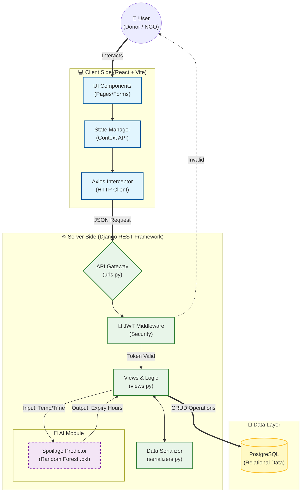
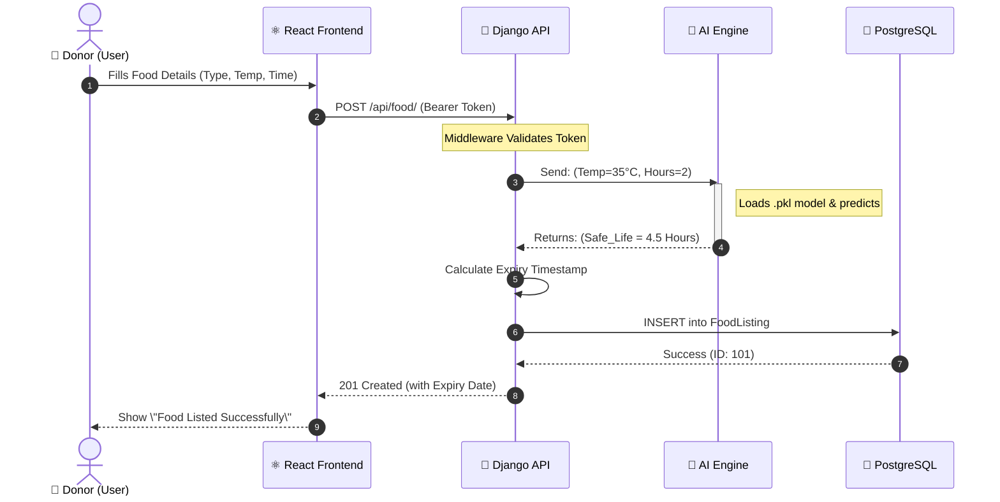

# 🍎 FoodSave – AI-Based Food Wastage Reduction System


> **\"Bridging the gap between surplus food and hunger using Artificial Intelligence.\"**

## 📖 Project Overview
**FoodSave** is a full-stack web application designed to minimize food wastage in the hospitality sector. It connects food donors (Hotels, Restaurants) with charitable organizations (NGOs) in real-time.

Unlike standard donation platforms, **FoodSave integrates a Machine Learning model (Random Forest)** to predict the \"Safe Consumption Time\" (Shelf Life) of cooked food based on environmental factors like temperature and preparation time. This ensures that only safe, hygienic food is distributed to the needy.

---

## 🚀 Key Features

### 🏨 For Donors (Hotels/Restaurants)
*   **Easy Listing:** Post surplus food details (Type, Quantity, Cooked Time).
*   **AI Safety Check:** Automated calculation of expiry time. The system rejects entries predicted to spoil before pickup.
*   **Impact Dashboard:** Gamified tracking of \"Total KGs Saved\" and \"People Fed\".

### 🤝 For NGOs (Receivers)
*   **Real-Time Feed:** View available food listings sorted by proximity and expiry time.
*   **Safety Indicators:** Green/Red indicators based on AI spoilage prediction.
*   **One-Click Claim:** Reserve food instantly and generate digital pickup receipts.

### 🤖 The AI Engine
*   **Algorithm:** Random Forest Regressor (Scikit-Learn).
*   **Inputs:** Food Type, Temperature (°C), Time Since Preparation.
*   **Output:** Estimated remaining safe hours.

---

## 🛠️ Technology Stack (Industry Standard)

| Component | Technology | Description |
| :--- | :--- | :--- |
| **Frontend** |   | Component-based UI with fast build tooling. |
| **Styling** |  | Utility-first CSS for rapid, responsive design. |
| **Backend** |   | Secure, high-performance API development. |
| **Database** |  | ACID-compliant relational database for data integrity. |
| **AI / ML** |   | Random Forest implementation for spoilage prediction. |
| **Auth** |  | Stateless authentication using SimpleJWT. |
| **Deploy** |   | CI/CD automated deployment pipeline. |

---

## ⚙️ Getting Started

### Prerequisites

- **Python** 3.10+
- **Node.js** 18+ & npm
- **PostgreSQL** 14+

### Backend Setup

```bash
# Navigate to backend directory
cd backend

# Create and activate a virtual environment
python -m venv venv
source venv/bin/activate   # On Windows: venv\Scripts\activate

# Install Python dependencies
pip install -r requirements.txt

# Configure environment variables
cp .env.example .env
# Edit .env with your PostgreSQL credentials and SECRET_KEY

# Apply migrations and start the server
python manage.py migrate
python manage.py runserver
```

### Frontend Setup

```bash
# Navigate to frontend directory
cd frontend

# Install dependencies
npm install

# Configure environment variables
cp .env.example .env
# Edit .env to set VITE_API_BASE_URL to your Django server URL

# Start the development server
npm run dev
```

---

## 🤝 Contributing

Contributions are welcome! Please fork the repository, create a feature branch, and open a pull request.

---

## 📄 License

This project is licensed under the **MIT License**. See the [LICENSE](LICENSE) file for details.

---

## 🏗️ System Architecture



## 🔄 AI Workflow


